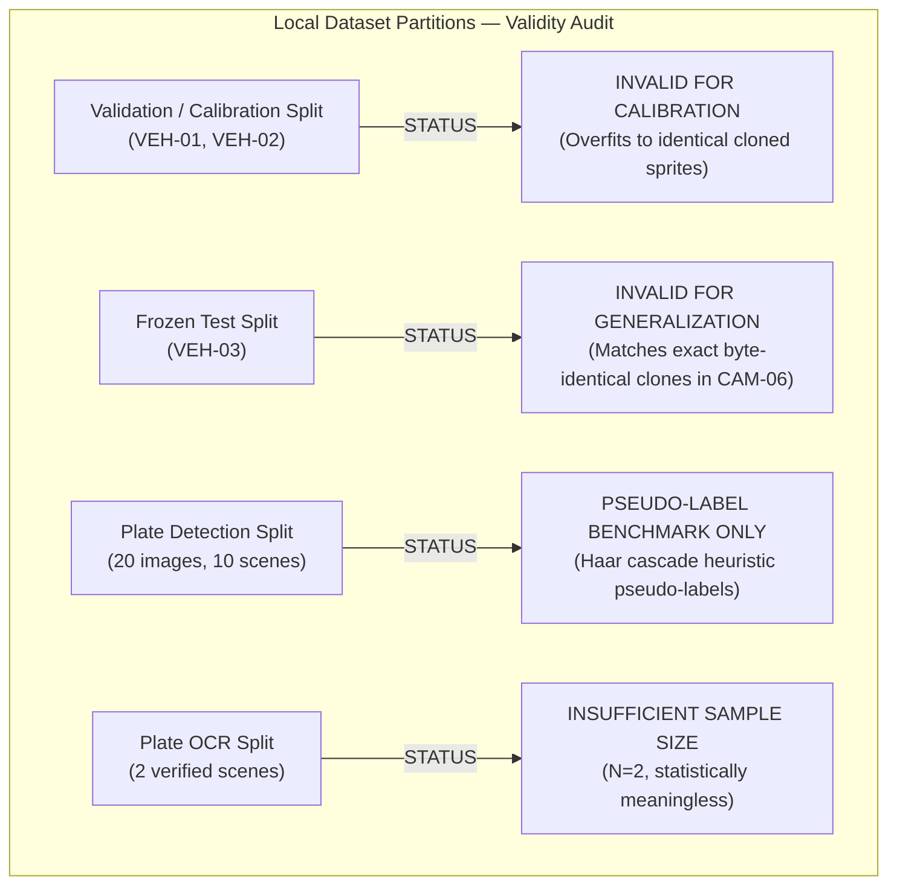

# Phase B — Evaluation Protocol & Dataset Quality Specification

> **Document Status:** Accepted Evaluation Foundation (Phase B, Batch B1.1 — Partition Invalidation & Quality Correction)  
> **Target System:** SIH26127 Traffic Intelligence & Multi-Camera Vehicle Investigation Platform  
> **Evaluation Readiness:** **INVALID FOR GENERALIZATION** — Local Dataset Cannot Support Generalization Claims  
> **Random Seed:** `42` (Deterministic)  
> **Associated Machine-Readable Manifests:**  
> - Dataset Inventory: [`data/benchmarks/dataset_manifest.json`](file:///c:/Users/Asus/OneDrive/Desktop/ai%20traffic/data/benchmarks/dataset_manifest.json)  
> - Partition Specification: [`data/benchmarks/partition_manifest.json`](file:///c:/Users/Asus/OneDrive/Desktop/ai%20traffic/data/benchmarks/partition_manifest.json)  
> - Audit Verification Log: [`data/benchmarks/batch_b1_dataset_audit.json`](file:///c:/Users/Asus/OneDrive/Desktop/ai%20traffic/data/benchmarks/batch_b1_dataset_audit.json)  

---

## 1. Executive Notice: Critical Dataset Audit & Partition Invalidation Findings

### 1.1 Invalidation of Local Re-ID Generalization Evaluation
The comprehensive provenance audit conducted in Batch B1 and corrected in Batch B1.1 establishes that **the local dataset CANNOT support Re-ID generalization evaluation or threshold calibration**:

1. **Test Partition Invalidation (`VEH-03`):**
   - The held-out test identity `VEH-03` consists of only **two unique images** duplicated across cameras `CAM-04` and `CAM-06`.
   - Probing `VEH-03_CAM-04_f75_t4.jpg` against the gallery matches `VEH-03_CAM-06_f75_t4.jpg`, which is a **byte-identical copy** (identical SHA-256: `cdb6c889...`).
   - Zero independent cross-camera positive targets exist for `VEH-03`.
   - Any Rank-1 or mAP scores computed on this test set evaluate exact byte matching, not visual re-identification across cameras.
2. **Validation Partition Invalidation (`VEH-01`, `VEH-02`):**
   - The validation identities `VEH-01` and `VEH-02` also consist of cloned images duplicated across cameras (`VEH-01` across `CAM-01`, `CAM-03`, `CAM-07`, `CAM-11`; `VEH-02` across `CAM-02`, `CAM-05`).
   - Calibrating association thresholds (`confirmed_threshold = 0.75`, `probable_threshold = 0.50`, `reid_high_similarity = 0.85`) on cloned images overfits directly to byte-level clone similarities, invalidating the calibration.
3. **Identity-Disjoint Splitting Does Not Eliminate Clone Leakage:**
   - Partitioning identities such that $\{ \text{VEH-01}, \text{VEH-02} \} \cap \{ \text{VEH-03} \} = \emptyset$ guarantees that validation and test share no common identity IDs.
   - However, **it does not eliminate duplicate-image leakage within an identity**. Because every cross-camera identity is formed by copying identical crops across camera folders, neither partition possesses independent cross-camera observations.
4. **Total Absence of Independent Cross-Camera Pairs:**
   - Across all 47 crops in [`data/benchmarks/reid_benchmark_crops/`](file:///c:/Users/Asus/OneDrive/Desktop/ai%20traffic/data/benchmarks/reid_benchmark_crops/), there are **zero (0) genuinely independent cross-camera observation pairs**.
   - No valid Re-ID test partition can be constructed from the local repository assets.

### 1.2 Invalidation of License Plate Detection & OCR Claims
1. **Plate Detection Pseudo-Labels:**
   - The 20 YOLO-formatted license plate samples (`data/dataset_samples/license_plates/`) were generated by a heuristic script (`scripts/prepare_plate_dataset.py` using Haar cascade and edge filtering).
   - They contain **zero human verification**.
   - Evaluating YOLO detector performance against these bounding boxes measures agreement with a heuristic script, not true ground-truth detection accuracy.
2. **Plate OCR Sample Insufficiency:**
   - Only **two (2) unique physical scenes** have verified ground-truth alphanumeric license plate strings (`gt/1.jpg` = `"MH15TC554"`, `gt/10.jpg` = `"KL55R2473"`).
   - A sample size of $N=2$ is statistically insufficient for calculating Character Error Rate (CER), Exact Match Accuracy, or Levenshtein distance with statistical validity.
   - Any OCR accuracy claim based on $N=2$ is unrepresentative and scientifically invalid.

---

## 2. Minimum Evidence Requirements for Valid Benchmarking

To prevent invalid evaluations, the system mandates the following minimum evidence thresholds before any benchmark or generalization claim is recognized:

### 2.1 Cross-Camera Vehicle Re-Identification
1. **Camera Physical Independence:** Probe and gallery captures must originate from distinct physical camera installations ($C_{\text{query}} \ne C_{\text{gallery}}$) with documented real-world spatial coordinates and non-trivial viewing angle/illumination differences.
2. **Image Independence:** 
   $$\text{SHA-256}(I_{\text{query}}) \ne \text{SHA-256}(I_{\text{gallery}})$$
   $$\text{dHash}(I_{\text{query}}, I_{\text{gallery}}) > \tau_{\text{distinct}}$$
   Images must be distinct sensor exposures captured at different physical camera viewpoints, not cloned image files or identical sprite animations pasted across folders.
3. **Independent Ground Truth:** True-positive identity linkage must be established by human ground-truth annotation or certified multi-sensor evidence (e.g., synchronized GPS track or RFID/Fastag toll log), never by automated script duplication.
4. **Non-Empty Gallery Positives:** Every evaluated cross-camera probe query must possess at least one independent true-positive target in the gallery.
5. **Domain-Representative Distractors:** Galleries must contain genuine negative distractors (unrelated vehicles) from the same surveillance environment.

### 2.2 License Plate Detection
1. **Human-Verified Bounding Boxes:** Benchmark datasets must possess human-reviewed bounding box ground truth. Pseudo-labeled heuristics must be explicitly isolated as agreement baselines, not accuracy benchmarks.

### 2.3 License Plate OCR
1. **Statistical Sample Size:** Valid OCR evaluation requires a minimum of $N \ge 500$ diverse, human-verified alphanumeric plate images covering multiple Indian state codes, vehicle classifications, font styles, and environmental degradations (blur, glare, occlusion, weather).

---

## 3. Complete Asset Provenance & Breakdown

### 3.1 47 Re-ID Benchmark Crops Provenance
Audited by [`scripts/audit_evaluation_datasets.py`](file:///c:/Users/Asus/OneDrive/Desktop/ai%20traffic/scripts/audit_evaluation_datasets.py):

| Identity | Crops | Unique SHA-256 | Cameras | Nature of Observations | Eligibility / Validity Status |
| :--- | :---: | :---: | :--- | :--- | :--- |
| `VEH-01` | 8 | 2 | `CAM-01, 03, 07, 11` | 2 unique crops duplicated 4x across 4 cameras | **INVALID** (Synthetic Clone Leakage) |
| `VEH-02` | 4 | 2 | `CAM-02, 05` | 2 unique crops duplicated 2x across 2 cameras | **INVALID** (Synthetic Clone Leakage) |
| `VEH-03` | 4 | 2 | `CAM-04, 06` | 2 unique crops duplicated 2x across 2 cameras | **INVALID** (Synthetic Clone Leakage) |
| `VEH-04` | 14 | 14 | `CAM-08` | Single-camera continuous tracklet (11 near-duplicate pairs) | **INELIGIBLE** (Single Camera Only) |
| `VEH-05` | 15 | 15 | `CAM-09` | Single-camera continuous tracklet (9 near-duplicate pairs) | **INELIGIBLE** (Single Camera Only) |
| `VEH-06` | 2 | 2 | `CAM-10` | Single-camera tracklet (sprite duplicate of VEH-03) | **INELIGIBLE** (Single Camera Only) |
| **Total** | **47** | **37** | **11** | **0 genuinely independent cross-camera pairs** | **INVALID FOR GENERALIZATION** |

### 3.2 Model Checkpoints
All 4 models in [`ai-service/models/`](file:///c:/Users/Asus/OneDrive/Desktop/ai%20traffic/ai-service/models/) were audited and cryptographically verified:
* `veri_sbs_R50-ibn.pth` (198,261,759 B): SHA-256 `57FB9C17D88911EA64390BF5427F43511435E7F88F6EED9DBC969D4B611E53CD` (**VERIFIED**)
* `yolov8s.pt` (22,588,772 B): SHA-256 `1F47A78BF100391C2A140B7AC73A1CAAE18C32779BE7D310658112F7AC9AA78A` (**VERIFIED**)
* `plate_detector_yolov8n.pt` (6,468,970 B): SHA-256 `5ABC6CE8989264228364598F2E0849B88BF419F64A54DFCFA3EE2B3B939C871E` (**VERIFIED**)
* `haarcascade_russian_plate_number.xml` (78,138 B): SHA-256 `8F0AA08869AA95307D76452FAAAF0D3A37A47A77F61B94EBB2CA58D4AC434FD4` (**VERIFIED**)

---

## 4. Corrected Partition Status (`partition_manifest.json`)



### 4.1 Re-ID Partitions Status
* **`validation_calibration_split`:**  
  * *Status:* `INVALID_FOR_CALIBRATION`  
  * *Identities:* `VEH-01`, `VEH-02` (12 crops, 4 unique hashes).  
  * *Reason:* Cross-camera pairs share identical image files. Tuning `confirmed_threshold` (0.75) or `reid_high_similarity` (0.85) on cloned images tunes thresholds against duplicate image noise rather than real cross-camera variance.
* **`frozen_test_split`:**  
  * *Status:* `INVALID_FOR_GENERALIZATION`  
  * *Identity:* `VEH-03` (4 crops, 2 unique hashes).  
  * *Reason:* Query `VEH-03_CAM-04_f75_t4.jpg` matches `VEH-03_CAM-06_f75_t4.jpg`, which is the exact same JPEG file. Zero independent cross-camera positive targets exist.
* **Single-Camera Vehicles (`VEH-04`, `VEH-05`, `VEH-06`):**  
  * Assigned strictly as **Gallery Negative Distractors** (31 crops).

### 4.2 License Plate Partitions Status
* **`plate_detection_partition_strategy`:**  
  * *Status:* `HEURISTIC_PSEUDOLABEL_BENCHMARK_ONLY`  
  * *Reason:* Bounding boxes were generated by `prepare_plate_dataset.py` heuristics. Human verification: `False`.
* **`plate_ocr_partition_strategy`:**  
  * *Status:* `INSUFFICIENT_FOR_PERFORMANCE_CLAIMS`  
  * *Reason:* Only two scenes have ground-truth strings (`gt/1.jpg` = `"MH15TC554"`, `gt/10.jpg` = `"KL55R2473"`). $N=2$ is statistically insufficient for calculating CER or Exact Match Accuracy.

---

## 5. Formal Evaluation Metric Equations & Denominators

| Pipeline Component | Metric | Mathematical Equation | Evaluation Unit | Explicit Denominator |
| :--- | :--- | :--- | :--- | :--- |
| **Vehicle Detection** | Precision | $\frac{TP}{TP + FP}$ | Percentage | Total predicted bounding boxes ($TP + FP$) |
| | Recall | $\frac{TP}{TP + FN}$ | Percentage | Total ground-truth vehicles ($TP + FN$) |
| | mAP@0.50 | $\frac{1}{\|C\|} \sum_{c \in C} AP_c^{0.50}$ | Percentage | Total vehicle classes $\|C\| = 4$ |
| | mAP@0.50:0.95 | $\frac{1}{10} \sum_{k=0}^9 \text{mAP@(0.50 + 0.05k)}$ | Percentage | 10 IoU thresholds (0.50 to 0.95) |
| **Plate Detection & OCR** | Detection Rate ($\text{PDR}_{0.5}$) | $\frac{TP_{\text{plate}}}{N_{\text{gt\_plates}}}$ | Percentage | Total ground-truth license plates ($N_{\text{gt\_plates}}$) |
| | Exact Match ($Acc_{\text{exact}}$) | $\frac{1}{N_{\text{eval}}} \sum \mathbb{I}(\text{clean}(\hat{S}) == \text{clean}(S^*))$ | Percentage | Evaluated plates with text ground truth ($N_{\text{eval}}$) |
| | Character Error Rate (CER) | $\frac{S + D + I}{\sum \text{Length}(S_i^*)}$ | Ratio $\ge 0.0$ | Total characters across ground-truth plate strings |
| | Norm. Levenshtein (NLD) | $\frac{\text{Levenshtein}(\hat{S}, S^*)}{\max(\text{Length}(\hat{S}), \text{Length}(S^*))}$ | Scalar $[0.0, 1.0]$ | $\max(\text{Length}(\hat{S}), \text{Length}(S^*))$ per string pair |
| **Vehicle Re-ID** | CMC Rank-$k$ | $\frac{1}{\|Q\|} \sum_{q \in Q} \mathbb{I}(\min_{g \in G_q^*} \text{rank}(g) \le k)$ | Percentage | Total valid cross-camera probe queries $\|Q\|$ |
| | mAP | $\frac{1}{\|Q\|} \sum_{q=1}^{\|Q\|} AP(q)$ | Percentage | $\|G_q^*\|$ for $AP(q)$; $\|Q\|$ for $\text{mAP}$ |
| **Identity Association** | Pairwise Precision | $\frac{TP_{\text{pair}}}{TP_{\text{pair}} + FP_{\text{pair}}}$ | Percentage | Total cross-camera pairs merged into same identity |
| | Pairwise Recall | $\frac{TP_{\text{pair}}}{TP_{\text{pair}} + FN_{\text{pair}}}$ | Percentage | Total cross-camera pairs from same physical vehicle |
| | False Match Rate (FMR) | $\frac{FP_{\text{pair}}}{FP_{\text{pair}} + TN_{\text{pair}}}$ | Percentage | Total negative cross-camera pairs (different vehicles) |
| | False Non-Match (FNMR) | $\frac{FN_{\text{pair}}}{TP_{\text{pair}} + FN_{\text{pair}}}$ | Percentage | Total positive cross-camera pairs (same vehicle) |
| | Uncertain Decision Rate | $\frac{N_{\text{PROBABLE\_REVIEW}}}{N_{\text{total\_candidates}}}$ | Percentage | Total candidate associations evaluated |
| **Operational Runtime** | Latency ($P_{50}, P_{90}, P_{99}$) | $P_k = \inf \{ t \mid F(t) \ge k/100 \}$ | Milliseconds | Total execution requests ($N_{\text{requests}}$) |
| | Throughput | $\frac{N_{\text{frames}}}{T_{\text{seconds}}}$ and $\frac{N_{\text{detections}}}{T_{\text{seconds}}}$ | FPS, Det/sec | Total wall-clock elapsed seconds ($T_{\text{seconds}}$) |

---

## 6. Reproducibility & Audit Verification Commands

To independently reproduce the complete quality, leakage, and partition validity audit:

```powershell
# 1. Run automated dataset quality and leakage audit
.\ai-service\venv\Scripts\python.exe scripts/audit_evaluation_datasets.py

# 2. Inspect generated audit report summary and partition flags
Get-Content data/benchmarks/batch_b1_dataset_audit.json | Select-String -Pattern "evaluation_readiness", "reid_evaluation_validity", "image_independence" -Context 0, 3

# 3. Assert partition validity status via Python
.\ai-service\venv\Scripts\python.exe -c "
import json
with open('data/benchmarks/partition_manifest.json') as f:
    p = json.load(f)
assert p['generalization_evaluation_supported'] is False, 'Generalization must be marked False!'
assert p['reid_partition_strategy']['validity_status'] == 'INVALID_FOR_GENERALIZATION'
print('Partition Invalidation Verified: Generalization correctly marked unsupported.')
"
```

---

## 7. Blockers & Prerequisites for Production-Grade Benchmarking

To replace this prototype foundation with certified production-grade evidence, the following requirements must be addressed:

| Item | Requirement | Current Status | Blocker Resolution Path |
| :--- | :--- | :--- | :--- |
| **1. Public Re-ID Benchmark** | VeRi-776 (776 vehicles, 20 cameras, 50,000 tracklets) | Pre-trained weights installed; raw dataset not present | Download and ingest official VeRi-776 dataset to `data/benchmarks/external/veri776/` |
| **2. Public Plate Benchmarks** | CCPD (250,000+ plates) and UFPR-ALPR (multi-angle video tracks) | Not installed locally | Ingest CCPD and UFPR-ALPR datasets to evaluate detector and OCR generalization |
| **3. Real Multi-Camera CCTV Footage** | Concurrent real-world surveillance video capturing authentic traffic flow | 11 synthetic composite video loops (6.0s each) | Ingest real multi-camera CCTV recordings with genuine traffic density and vehicle transits |
| **4. Alphanumeric OCR Ground Truth** | Minimum $N \ge 500$ verified license plate character strings | 0 character labels in YOLO format; only 2 manual plates documented | Annotate local plate crops with standardized text ground truth in `dataset_manifest.json` |
| **5. Adverse Weather Surveillance** | Rain, dense fog, nighttime glare, camera lens occlusions | 5 paired synthetic hazy samples | Ingest real adverse weather traffic footage to evaluate dehazing and enhancement pipelines |

---
**Protocol Acceptance:** Phase B, Batch B1.1 complete. Partitions formally marked INVALID for generalization.
