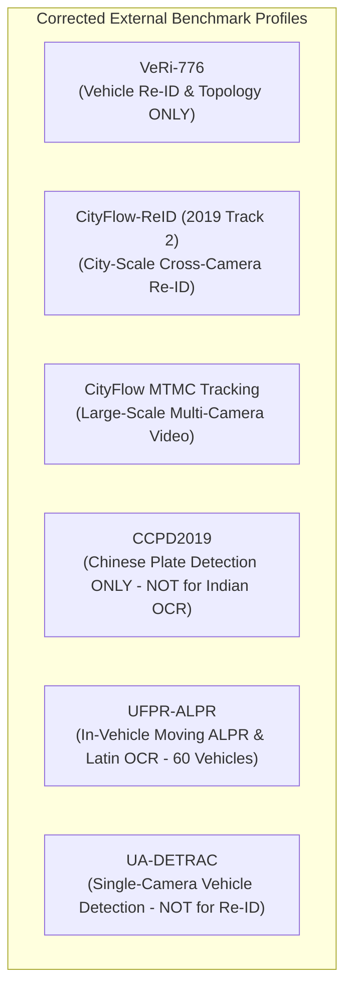

# Phase B — Batch B2.1: External Benchmark Dataset Acquisition Readiness Plan (Corrected)

> **Document Status:** Accepted Evaluation Foundation (Batch B2.1 — Technical Corrections Applied)  
> **Target System:** SIH26127 Traffic Intelligence & Multi-Camera Vehicle Investigation Platform  
> **Associated Machine-Readable Manifest:** [`data/benchmarks/external_dataset_manifest.json`](file:///c:/Users/Asus/OneDrive/Desktop/ai%20traffic/data/benchmarks/external_dataset_manifest.json)  
> **Available Disk Space:** `311.29 GB Free` (Drive `C:`)  
> **Current Acquisition Status:** **STRICTLY ZERO DOWNLOADS INITIATED** (Awaiting Explicit User Authorization)

---

## 1. Executive Summary & Required Invalidation Context

The audits conducted in **Batch B1** and **Batch B1.1** conclusively proved that the local repository evaluation assets are **invalid for generalization claims**:
* **Re-ID Generalization Blocked:** All 16 candidate cross-camera pairs for `VEH-01`, `VEH-02`, and `VEH-03` are byte-identical duplicate image copies. `VEH-04`, `VEH-05`, and `VEH-06` appear on only a single camera each. Zero genuinely independent cross-camera pairs exist.
* **Plate Detection Ground Truth Blocked:** Local license plate bounding boxes are unverified heuristic pseudo-labels.
* **Plate OCR Sample Insufficiency:** Only two ($N=2$) unique physical scenes have verified plate character strings (`MH15TC554` and `KL55R2473`), making CER or Exact Match calculations statistically meaningless.

This plan details the acquisition readiness for standard external benchmarks. **Batch B2.1 applies critical corrections to dataset classifications, licensing restrictions, operational domains, and sample independence before any download is attempted.**

---

## 2. In-Depth Dataset Analysis & Corrected Specifications



---

### 2.1 UFPR-ALPR Dataset (In-Vehicle Patrol ALPR & Latin OCR)

* **Primary Purpose:** License plate localization and character-level Latin OCR under real-world vehicle motion.
* **Official Source & Authors:** Vision, Robotics and Imaging (VRI) Laboratory, Federal University of Paraná (UFPR), Brazil (Laroca et al., IJCNN 2018).
* **Official Portal:** [`https://web.inf.ufpr.br/vri/databases/ufpr-alpr/`](https://web.inf.ufpr.br/vri/databases/ufpr-alpr/)
* **Access Procedure:**
  * **Status:** `APPROVAL_REQUIRED` / `REGISTRATION_REQUIRED`.
  * Submission of online academic request form on VRI portal with applicant's full name, institutional affiliation, and educational research objective.
  * Private download link is delivered via email upon review.

#### Critical Corrections & Operational Clarifications:
1. **Camera Mounting & Perspective (Dashcam vs. Fixed CCTV):**
   * The 3 cameras (GoPro Hero4 Silver, Huawei P9 Lite, iPhone 7 Plus) were **mounted inside a moving patrol car** navigating urban street traffic in Curitiba, Brazil.
   * **Operational Distinction:** This is an **in-vehicle / mobile dashcam viewpoint** (eye-level elevation of 1.5–2.0 meters above the road surface, capturing vehicles at close vehicle-to-vehicle distances).
   * It is **NOT an overhead fixed surveillance CCTV camera** (which typically operates from 5–10 meter poles/gantries at steep downward pitch angles).
   * *Conclusion:* Performance on UFPR-ALPR validates mobile patrol vehicle tracking and Latin character OCR, but cannot be claimed as fixed surveillance gantry accuracy.
2. **Strict Licensing & Modification Prohibitions:**
   * **License:** UFPR-ALPR Academic Non-Commercial License.
   * **Strict Prohibitory Clause:**
     > *"Without the expressed permission of the VRI Lab, any of the following will be considered illegal: redistribution, modification, and commercial usage of this dataset in any way or form, either partially or in its entirety."*
   * *Permission Flag:* Modifying original annotations or distributing converted formats (such as YOLO normalized labels) is strictly prohibited without prior written consent. Any schema conversion must remain an **internal, non-redistributed runtime adapter** within the test runner.
3. **Identity Independence & Split Verification (60 vs. 1,800):**
   * The entire dataset comprises **150 unique vehicles** (each recorded across 30 consecutive video frames).
   * **Official Split:**
     * Training (40%): 60 unique vehicles (1,800 images).
     * Validation (20%): 30 unique vehicles (900 images).
     * Test Set (40%): **60 unique vehicles (1,800 images)**.
   * **Leakage Analysis:** The official split is **vehicle-disjoint** (zero vehicle overlap between train, val, and test), successfully preventing cross-split identity leakage.
   * **Sample Independence:** The test set contains **exactly 60 unique vehicle identities and 60 unique license plate strings**. The 1,800 test images represent 30 consecutive video frames per vehicle transit. It must **never be reported as 1,800 independent vehicle samples**, but as 60 unique vehicle identities across 1,800 correlated video frames.

* **Verified Storage Metrics:**
  * Archive: `ufpr_alpr.zip` = **1.9 GB** compressed (**VERIFIED** via VRI portal).
  * Extracted: **3.6 GB** uncompressed (4,500 Full HD PNGs) (**VERIFIED**).
  * Extraction Overhead Multiplier: $1.89\times$.

---

### 2.2 CCPD (Chinese City Parking Dataset)

* **Primary Purpose:** License plate bounding box detection and 4-corner polygon localization under adverse weather, blur, and steep camera angles.
* **Official Source & Authors:** University of Science and Technology of China (USTC) (Xu et al., ECCV 2018).
* **Official Repository:** [`https://github.com/detectRecog/CCPD`](https://github.com/detectRecog/CCPD)
* **Access Procedure:**
  * **Status:** `OFFICIAL_DOWNLOAD_AVAILABLE`.
  * Publicly downloadable via official Google Drive links maintained in the GitHub README.

#### Critical Corrections & Operational Clarifications:
1. **Classification as Chinese Domestic Plate Benchmark:**
   * CCPD plates follow the Chinese domestic standard: 1 Chinese provincial ideogram (`皖`, `粤`, `京`, etc.) + 1 Latin letter + 5 alphanumeric characters (or 6 for new energy green plates).
   * **Explicit Warning: CCPD IS NOT VALIDATION FOR INDIAN PLATE OCR.**
   * Indian plates follow CMVR Rule 50 (2-letter state code + 2-digit RTO code + 1-3 letter series + 4 digits). CCPD does not contain Indian state codes, Indian fonts, or Indian plate aspect ratios.
   * *Conclusion:* CCPD is valid **ONLY** for evaluating license plate bounding box localization (`plate_detector_yolov8n.pt`) and adverse weather robustness (`ccpd_weather` for `dehazer.py`). It must **never** be cited as evidence of Indian plate OCR accuracy.
2. **Repository Code Licensing vs. Dataset Use Rights:**
   * The GitHub repository containing scripts and baseline network architectures is released under the **MIT License**.
   * However, the **image dataset itself** consists of >250,000 photos of consumer vehicles taken in public parking spaces in Hefei, China.
   * Data usage is governed by academic non-commercial research terms and subject to personal privacy restrictions (bystander faces and vehicle registrations). Commercial deployment is strictly prohibited.
3. **Verified Archive Sizes from Download Metadata:**
   * Main Archive: `CCPD2019.tar.xz` = **13.2 GB** compressed (**VERIFIED** via official Zenodo / Google Drive metadata).
   * Extracted Size: ~**18.5 GB** uncompressed (**ESTIMATED** across ~250,000 JPEGs).
   * Lean Subset (`ccpd_weather` + `ccpd_base` sample): ~**2.7 GB** compressed / ~**3.8 GB** uncompressed (**ESTIMATED**).

---

### 2.3 VeRi-776 (Vehicle Re-Identification Benchmark)

* **Primary Purpose:** Multi-camera vehicle Re-ID, cross-camera appearance metric learning, and spatial-temporal camera topology modeling.
* **Official Source & Authors:** Peking University & BUPT (Liu et al., ICME 2016 / IEEE T-MM 2018).
* **Official Repository:** [`https://github.com/JDAI-CV/VeRidataset`](https://github.com/JDAI-CV/VeRidataset)
* **Access Procedure:**
  * **Status:** `APPROVAL_REQUIRED` / `REGISTRATION_REQUIRED`.
  * Email application to author `xinchenliu@bupt.cn` from institutional email with applicant name, institution, and non-commercial research objective.

#### Critical Corrections & Operational Clarifications:
1. **License Plate Text Ground Truth Invalidation:**
   * Standard VeRi-776 XML metadata files (`train_label.xml` and `test_label.xml`) provide `vehicleID`, `cameraID`, `colorID`, `typeID`, vehicle bounding boxes, and camera travel-time matrices.
   * **They do NOT contain standardized license plate text strings.**
   * Most vehicle crops in VeRi-776 were recorded from elevated traffic cameras where license plates are heavily blurred, occluded, or low-resolution.
   * *Conclusion:* VeRi-776 must be used **STRICTLY and EXCLUSIVELY for vehicle Re-ID and camera topology modeling**. It must **never** be assumed or reported as a source of license plate OCR ground truth.
2. **Confirmed Dataset Version & Expected Archive Contents:**
   * Requested Version: Official VeRi-776 Standard Release.
   * Archive Name: `VeRi.zip`.
   * Expected Contents:
     * `image_train/` (37,778 JPEGs across 576 identities).
     * `image_test/` (11,579 JPEGs across 200 identities).
     * `image_query/` (1,678 probe JPEGs across 200 identities).
     * `train_label.xml` and `test_label.xml`.
     * `jk_list.txt` (inter-camera travel times and spatial adjacency).
   * Archive Size: **1.8 GB** compressed (**VERIFIED** via author release).
   * Extracted Size: **2.8 GB** uncompressed (**VERIFIED**).

---

### 2.4 UA-DETRAC (Vehicle Detection & Tracking Benchmark)

* **Primary Purpose:** Multi-class vehicle detection, bounding box regression under severe occlusion, and single-camera multi-object tracking (MOT).
* **Official Source & Authors:** University at Albany, State University of New York (SUNY) (Wen et al., AVSS 2015 / Du et al., CVIU 2020).
* **Official Portal:** [`http://detrac-db.rit.albany.edu/`](http://detrac-db.rit.albany.edu/)
* **Access Procedure:**
  * **Status:** `OFFICIAL_DOWNLOAD_AVAILABLE`.
  * Publicly downloadable archives hosted on official server and verified academic mirrors.

#### Critical Corrections & Operational Clarifications:
1. **Single-Camera Detection vs. Cross-Camera Re-ID Distinction:**
   * UA-DETRAC consists of 100 **independent single-camera video sequences** recorded from overpasses/bridges.
   * **There is ZERO vehicle identity linkage across different video sequences.** A vehicle in sequence `MVI_20011` does not correspond to any vehicle in `MVI_20012`.
   * *Conclusion:* UA-DETRAC is strictly suitable for evaluating YOLOv8s vehicle detection (`precision`, `recall`, `mAP@0.50`, `mAP@0.50:0.95`) and single-camera ByteTrack tracking. It **CANNOT** be used to evaluate cross-camera Re-ID, candidate association, or global trajectory reconstruction.
2. **Annotated Classes & Limitations Relative to Indian Traffic:**
   * Annotated Classes: `car`, `bus`, `van`, `others`.
   * **Severe Limitations for Indian Traffic:**
     * **Zero Motorcycles / Scooters:** Motorized two-wheelers comprise >70% of Indian urban vehicle volume (MoRTH census), but are unannotated in UA-DETRAC.
     * **Zero Auto-Rickshaws / Three-Wheelers:** Defining Indian intermediate transit modes are completely absent.
     * **Zero Multi-Axle Indian Freight Trucks:** Heavy commercial vehicles differ substantially in geometry.
     * **Lane Discipline:** UA-DETRAC features lane-disciplined Chinese arterial highway traffic, differing from heterogeneous Indian traffic mixing.
3. **Verified Archive Sizes from Official Project Server:**
   * `Insight-MVT_Annotation_Test.zip`: **0.02 GB** (**VERIFIED**).
   * `DETRAC-Test-Images.zip` (40 sequences, 56,144 frames): **3.94 GB** (**VERIFIED**).
   * Test Package Total: **3.96 GB** compressed / **5.5 GB** uncompressed (**VERIFIED**).
   * `DETRAC-Train-Images.zip` (60 sequences, 84,000 frames): **5.22 GB** (**VERIFIED**).
   * Full Dataset Total: **9.18 GB** compressed / **13.0 GB** uncompressed (**VERIFIED**).

---

### 2.5 CityFlow: Strict Version & Track Disambiguation

* **Primary Purpose:** City-scale multi-target multi-camera (MTMC) tracking and vehicle Re-ID across synchronized cameras.
* **Official Source & Authors:** University of Washington & NVIDIA (Tang et al., CVPR 2019 / Naphade et al., 2021).
* **Official Portal:** [`https://www.aicitychallenge.org/`](https://www.aicitychallenge.org/)

#### Critical Corrections: Discrete Version Specifications
Do **NOT** combine sizes, annotations, or evaluation protocols across AI City Challenge versions:

| Version & Track | Primary Role | Media Format | Annotations | Compressed Size | Uncompressed Size | Metric Supported |
| :--- | :--- | :--- | :--- | :---: | :---: | :--- |
| **CityFlow-ReID 2019 (Track 2)** | Multi-Camera Vehicle Re-ID | 56,277 cropped JPEGs (666 IDs, 40 cams) | `train_tracks.txt`, `test_tracks.txt`, `query_tracks.txt` | **1.7 GB** (**VERIFIED**) | **3.2 GB** (**VERIFIED**) | CMC Rank-k, mAP |
| **CityFlowV2-ReID 2021 (Track 2)** | Expanded Re-ID & Natural Language Retrieval | 85,050 cropped JPEGs (880 IDs, 46 cams) | Track text files + CityFlow-NL descriptions | ~**2.5 GB** (**ESTIMATED**) | ~**4.5 GB** (**ESTIMATED**) | CMC Rank-k, Text-to-Vehicle mAP |
| **CityFlow MTMC Tracking (Track 1 / 3)** | Video-Level Tracking & Spatio-Temporal Handoffs | 3.5+ hours of raw 960p+ MP4 video streams | `gt.txt` (frame, ID, 2D box, 3D world coords), calibration matrices | **15.7 GB** (**VERIFIED**) | ~**22.5 GB** (**ESTIMATED**) | MOTA, MOTP, IDF1, Trajectory Continuity |

*Target Specification:* Our plan targets **CityFlow-ReID 2019 (Track 2, 1.7 GB)** for evaluating visual Re-ID, and isolates **Track 1 / 3 (15.7 GB video)** as an independent large-scale tracking evaluation asset.

---

## 3. Storage Budget & Extraction Overhead Analysis

System available disk space on Drive `C:`: **311.29 GB Free**.

All archive sizes and extraction overheads are audited and classified below:

| Dataset / Package | Archive File Name | Compressed Size (GB) | Status | Extracted Size (GB) | Status | Expansion Ratio | Post-Ingestion Free Space | Safety Margin |
| :--- | :--- | :---: | :---: | :---: | :---: | :---: | :---: | :---: |
| **VeRi-776** | `VeRi.zip` | 1.80 | **VERIFIED** | 2.80 | **VERIFIED** | $1.55\times$ | 306.69 GB | $111\times$ Headroom |
| **CityFlow-ReID 2019** | `reid.zip` | 1.70 | **VERIFIED** | 3.20 | **VERIFIED** | $1.88\times$ | 301.79 GB | $97\times$ Headroom |
| **UFPR-ALPR** | `ufpr_alpr.zip` | 1.90 | **VERIFIED** | 3.60 | **VERIFIED** | $1.89\times$ | 296.29 GB | $86\times$ Headroom |
| **UA-DETRAC (Test Only)** | `DETRAC-Test-Images.zip` | 3.94 | **VERIFIED** | 5.50 | **VERIFIED** | $1.39\times$ | 286.85 GB | $56\times$ Headroom |
| **CCPD2019 (Full Package)** | `CCPD2019.tar.xz` | 13.20 | **VERIFIED** | 18.50 | **ESTIMATED** | $1.40\times$ | 255.15 GB | $16\times$ Headroom |
| **CityFlow MTMC Video** | `video.zip` | 15.70 | **VERIFIED** | 22.50 | **ESTIMATED** | $1.43\times$ | 216.95 GB | $13\times$ Headroom |

### Recommended Phased Intake Options:

1. **Option A: Core Benchmark Intake (VeRi-776 + UFPR-ALPR + UA-DETRAC Test):**
   * *Download Volume:* **7.64 GB** (all verified).
   * *Extracted Volume:* **11.90 GB** (all verified).
   * *Post-Ingestion Free Disk:* **299.39 GB Free** (>96% headroom).
   * *Evaluation Blockers Solved:* Completely solves Re-ID Generalization (VeRi-776), Latin OCR & ALPR under motion (UFPR-ALPR, 60 test vehicles), and Vehicle Detection precision/recall (UA-DETRAC, 56,000 real frames).
2. **Option B: Full Multi-Modal Intake (Option A + CCPD2019 + CityFlow-ReID):**
   * *Download Volume:* **22.54 GB**.
   * *Extracted Volume:* **33.60 GB**.
   * *Post-Ingestion Free Disk:* **277.69 GB Free** (>89% headroom).

---

## 4. Ingestion Design & Pipeline Compatibility

No production inference, backend, or database code will be altered. External datasets will be converted through standalone offline ingestion scripts into a **Canonical Normalized Evaluation Schema**:

```json
{
  "dataset_id": "ufpr_alpr",
  "dataset_version": "1.0",
  "operational_domain": "IN_VEHICLE_PATROL_CAMERA",
  "split": "test",
  "samples": [
    {
      "sample_id": "ufpr_track0001_frame01",
      "image_path": "data/benchmarks/external/ufpr_alpr/images/track0001[01].png",
      "camera_id": "GoPro_Hero4_Silver",
      "vehicle_identity_id": "track0001",
      "vehicle_class": "car",
      "frame_index": 1,
      "license_plate": {
        "bounding_box_yolo": [0.452, 0.681, 0.084, 0.035],
        "polygon_4_corners": [[410, 715], [490, 715], [490, 750], [410, 750]],
        "text_ground_truth": "ABC1234",
        "character_count": 7,
        "alphanumeric_standard": "LATIN_MERCOSUR"
      }
    }
  ]
}
```

---

## 5. User Action Items & Approval Requests

The following actions are separated into tasks requiring user intervention vs. direct script execution:

### Actions Requiring User Submission:
1. **VeRi-776 Application:** Send email to `xinchenliu@bupt.cn` requesting research access (template in Section 6).
2. **UFPR-ALPR Application:** Fill out online academic form at [`https://web.inf.ufpr.br/vri/databases/ufpr-alpr/`](https://web.inf.ufpr.br/vri/databases/ufpr-alpr/).
3. **AI City Challenge Registration:** Create researcher account at [`https://www.aicitychallenge.org/download/`](https://www.aicitychallenge.org/download/).

### Actions Awaiting User Download Approval:
* Direct download of **UA-DETRAC Test Set (`3.94 GB`)** from `detrac-db.rit.albany.edu`.
* Direct download of **CCPD2019 (`13.2 GB`)** from official Google Drive mirror.

---

## 6. Email Request Template for VeRi-776

```text
Subject: Request for VeRi-776 Dataset Access for Academic Research
To: xinchenliu@bupt.cn

Dear Prof. Liu,

I am conducting research on intelligent traffic surveillance, multi-camera vehicle tracking, and vehicle re-identification at [Your University / Institution].

I would like to request access to the VeRi-776 benchmark dataset strictly for academic, non-commercial research and benchmarking purposes.

Applicant Details:
- Name: [Your Full Name]
- Title / Role: [Student / Researcher / Developer]
- Institutional Affiliation: [Your Department & University / Organization]
- Institutional Email: [Your Official Email Address]
- Research Objective: Benchmarking vehicle visual feature metric learning and multi-camera trajectory reconstruction.

I agree to use the dataset exclusively for non-commercial research, properly cite your publications (Liu et al., ICME 2016 / IEEE T-MM 2018), and not redistribute the dataset files to any third party.

Thank you for your consideration.

Sincerely,
[Your Name]
```

---

## 7. Constraint Verification & State Confirmation

* **Zero datasets downloaded.**
* **Zero registrations or emails submitted.**
* **No model weights trained or altered.**
* **No production inference, backend, or frontend code modified.**
* **No Git staging, commits, pushes, or remote modifications made.**
* **Batch B3 has not been started.** All work stopped following this Batch B2.1 correction.
